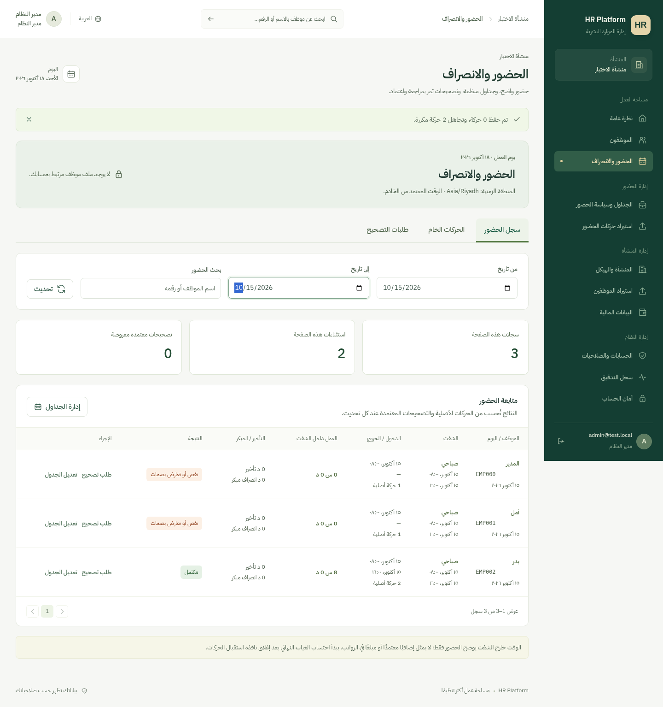

# الحضور والجداول — 18 أكتوبر 2026

أضيفت وحدة حضور فعلية مرتبطة بملفات الموظفين، مع شاشات عربية للإدارة والموظف والمدير. الصور أدناه بيانات اختبار اصطناعية فقط.



## ما يعمل

1. إنشاء تعريفات شفتات نهارية أو عابرة لمنتصف الليل. الحد التشغيلي الحالي 16 ساعة للشفت؛ وقت البداية والنهاية، استراحة غير مدفوعة داخل الشفت، سماح وصول وانصراف، ونافذة التقاط قبل/بعد الشفت. التعريف ثابت بعد الحفظ؛ لتغيير السياسة يُنشأ تعريف بديل حتى لا تتغير الجداول السابقة ضمنيًا.
2. توزيع جدول ثابت أو متغير على مجموعة حتى 100 موظف خلال 31 يومًا. أيام الأسبوع غير المحددة راحة. تعديل يوم بعينه من التقرير يطلب نسخة السجل وسبب التغيير. يمنع تكرار اليوم والتداخل بين الشفتات ونوافذ التقاط حركاتها؛ لا يستبدل جدولًا قائمًا في توزيع جماعي.
3. إضافة عطلات منشأة بتواريخ يحددها المسؤول، وحذفها مع فحص نسخة السجل. لا تُستورد تواريخ نظامية غير متحققة تلقائيًا.
4. استيراد حركات Excel بقالب ومعاينة، مع توقيت يتضمن فرق المنطقة، ومنع الصيغ وتضخم المحتوى المضغوط، وحد 2000 حركة و2 MB. الحفظ يعيد التحقق، ويكون ذريًا عند وجود أخطاء. يتجاهل التكرار المطابق للموظف والوقت UTC والنوع، بما في ذلك إعادة استيراد ملف سابق أو المصدر المختلف.
5. تقرير يُحسب من الحركات الأصلية والتصحيحات المعتمدة عند كل تحميل: العمل داخل الشفت، التأخير، الانصراف المبكر، الغياب بعد إغلاق نافذة التقاط الحركات، النقص والتعارض، والحضور خارج الشفت. مؤشرات الشاشة تخص السجلات المعروضة في الصفحة، وتُسمى بهذا الوضوح. الفلاتر والترقيم من الخادم.
6. الموظف يقدم تصحيح يومه، أو الموارد البشرية تقدمه بالنيابة. يعتمد المدير المباشر أو الموارد البشرية طلبات نطاقه؛ يمنع اعتماد مقدم الطلب أو من يخصه الحضور لطلبه الشخصي. يحجز اليوم طلب معلق أو معتمد، ويسمح بسحب المعلق وإعادة تقديمه. القرارات تستخدم نسخة السجل لمنع اعتمادين متزامنين؛ المرفوض والمسحوب يبقيان في السجل.
7. التصحيح المعتمد يضيف طبقة حساب ولا يعدل الحركة الخام. تبقى تعريفات الشفت والحركات الخام دون تعديل من التطبيق، وتُسجل التغييرات والقرارات تحت حساب من أجراها.
8. تسجيل اختياري من بوابة الموظف يفعله مدير النظام فقط. يشترط موظفًا نشطًا مرتبطًا بالحساب، وشفتًا حاليًا، والتتابع بين الدخول والخروج. التوقيت من TimeProvider على الخادم، ومعرف الطلب يمنع تكرار الإرسال عند إعادة المحاولة. لا تدّعي هذه الميزة إثبات الموقع أو منع التلاعب الجغرافي.

## قواعد الحساب الحالية

- يوم الشفت الليلي هو تاريخ بدايته، ويشمل خروج اليوم التالي ضمن نافذة التقاطه. تُرفض النوافذ المتقاطعة حتى لا تُحتسب الحركة في يومين. الحركات التي تخص شفتًا ليليًا لا تنسب مرة ثانية إلى يوم الراحة التالي.
- أوقات الجدول محفوظة مع اسم منطقة المنشأة وقت توزيعه. تغيير المنطقة لاحقًا لا يعيد تفسير الجداول السابقة. الأوقات الغامضة أو غير الموجودة بسبب التوقيت الصيفي تُرفض بدل التخمين.
- العمل يُحسب من أزواج دخول/خروج صالحة داخل الشفت. تُخصم الاستراحة بقدر تداخلها مع الأزواج فقط. الدقائق المكتملة تُقرب لأسفل للعمل؛ التأخير والمبكر لأعلى ثم يُخصم السماح. النقص أو تتابع نوعين متشابهين يولّد استثناءً.
- الحضور خارج الشفت يُعرض منفصلًا. **ليس إضافيًا معتمدًا ولا مدخل راتب**. أيام الراحة والعطلات لا تولد غيابًا. لا يُفترض الحضور عند غياب بصمة خروج.
- النتائج مشتقة عند القراءة ولا توجد سجلات نتائج ثابتة أو كشوف رواتب مقفلة في هذه المرحلة. أي تعديل مخول للجدول أو العطلة يؤثر في الحساب التالي ويُسجل. التكامل مع الإجازات والمسيرات والإضافي المعتمد يتبع المراحل القادمة.

## الصلاحيات

| الحساب | الوصول |
|---|---|
| Administrator / HR | جداول المنشأة، العطلات، الاستيراد، التقارير، والتصحيح؛ سياسة البوابة لمدير النظام فقط |
| Manager | جدوله وفريقه المباشر وطلباتهم؛ يعتمد دون اعتماد نفسه أو ما قدمه |
| Employee | حضوره وحركاته وطلباته فقط |
| Payroll فقط | لا صلاحية لوحدة الحضور؛ تظل صلاحيات البيانات المالية منفصلة |

## تحديث نسخة Windows الحالية

استخدم أداة تحديث الشيفرة الموثقة مع رقم النسخة وSHA256 من رسالة التسليم. أوقف التطبيق قبل التحديث. تحفظ الأداة الشيفرة القديمة وتستثني إعداداتك وملفاتك الخاصة. تستعيد الحزم وتختبر وتنسخ الواجهة عند `-Apply -Build`.

**هذا الإصدار يحتاج ترحيلًا جديدًا بعد تحديث الشيفرة**؛ يضيف الجداول والفهارس الخاصة بالحضور دون تعديل جداول الموظفين والحسابات الحالية. يستمر استخدام قاعدة المشروع المعتمدة `HRPlatform_Dev` على جهازك، واتصال Windows Authentication المحفوظ. لا حاجة إلى --bootstrap أو إعادة إنشاء الحسابات.

من جذر `C:\HR-System-main`، بعد نجاح أداة التحديث:

```powershell
$env:ASPNETCORE_ENVIRONMENT = 'Development'
dotnet run --project .\src\HR.Api -- --migrate
# انتظر: HR Platform migrations applied.
dotnet run --project .\src\HR.Api -- --urls 'https://localhost:7080;http://localhost:5080'
```

الترحيل لا يعمل تلقائيًا عند التشغيل العادي. حارس اسم القاعدة وسجل الترحيلات ما زال فعالًا. احتفظ بنسخة قاعدة البيانات وفق [دليل النسخ والاستعادة](deployment.md) قبل ترقية بيئة تحتوي بيانات فعلية. اختبار الترحيل وتدفق القبول على SQL Server لدى المستخدم ما زال منفصلًا عن اختبارات SQLite السحابية.

ابدأ بإنشاء الشفت، ثم توزيع الجداول وإضافة العطلات، ثم استيراد الحركات. الموظف يدخل «حضوري»، والمدير يدخل «طلبات التصحيح» من شاشة الحضور. تسجيل البوابة غير مفعل افتراضيًا.


