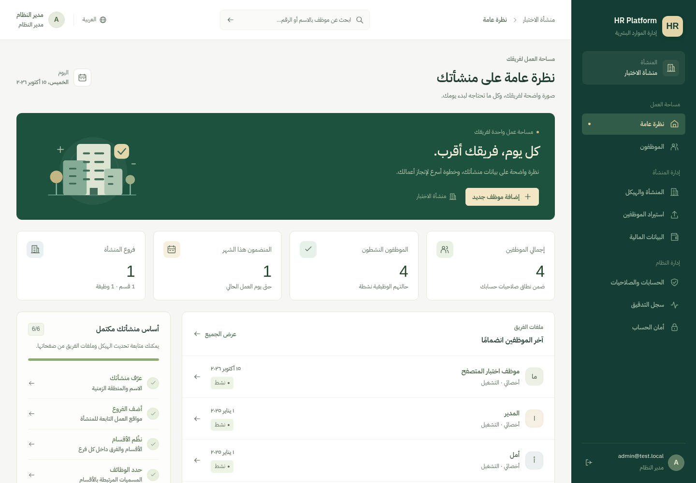
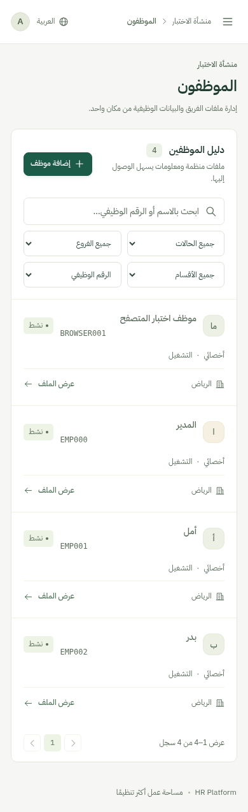

> ملاحظة: هذه تعليمات دفعة التصميم بتاريخ 2026-10-15. إصدار الحضور اللاحق يحتاج ترحيلًا إضافيًا؛ استخدم [دليل تحديث الحضور](attendance.md) عند تثبيت الإصدار الحالي.

# تحديث تجربة الاستخدام

شاشة دخول جديدة، مساحة عمل بخط عربي محلي وتنقل واضح، ولوحة متابعة تتصل ببيانات المنشأة وصلاحيات الحساب. لا بيانات حضور أو رواتب شكلية.



دليل الموظفين يدعم البحث والفلاتر والترتيب من الخادم، ويعرض الوظيفة والقسم والفرع. ملف الموظف يجمع البيانات والمرفقات المسموحة، ويحذر عند إغلاق تعديلات لم تحفظ. الصفحة والملف يبقيان مفتوحين بعد تحديث المتصفح. الجوال يعرض بطاقات موظفين وقائمة جانبية ونماذج قابلة للتمرير.



## تثبيت التحديث على نسخة ZIP الحالية

أوقف التطبيق في نافذة تشغيله باستخدام Ctrl+C، وأبق SQL Server يعمل. لا تعِد إنشاء قاعدة HRPlatform_Dev أو مدير النظام. لا يحتاج هذا التحديث إلى --migrate أو --bootstrap أو تغيير شهادة SQL.

من جذر المشروع في PowerShell، شغّل أداة التحديث التي تصلك مع رقم النسخة وقيمة SHA256 الموثقين في رسالة التسليم. الأداة [Update-LocalProject.ps1](../scripts/Update-LocalProject.ps1):

```powershell
# مثال الصيغة؛ خذ رقم النسخة وSHA256 من رسالة التسليم.
.\scripts\Update-LocalProject.ps1 -Revision '<40-character commit>' -ArchiveSha256 '<64-character SHA256>' -Apply -Build
```

- تتحقق من أرشيف نسخة ثابتة قبل نسخ أي ملف، وتحفظ الشيفرة التي ستستبدل في `.local\updates\<timestamp>\source` مع `manifest.json` للملفات الأصلية والجديدة.
- لا تستبدل appsettings*.json أو launchSettings.json أو .env، ولا تنسخ المرفقات أو قواعد البيانات أو مفاتيحها. User Secrets خارج مجلد المشروع لا تمسها الأداة. تحفظ ملفات المستخدم غير الموجودة في الحزمة.
- `-Build` يستعيد الحزم المقفلة ويشغل اختبارات الخادم والواجهة ويبنيها، ثم ينسخ ناتج الواجهة إلى wwwroot. لا يشغل أي أمر قاعدة بيانات أو خدمة SQL. عند فشل خطوة يتوقف ويطبع مسار النسخة الاحتياطية؛ لا تشغّل التطبيق قبل حل الخطأ.
- بدون `-Apply`، ينزّل الحزمة ويتحقق منها ويعرض عدد ملفات التحديث فقط. الأداة مخصصة لنسخة ZIP؛ إن كانت النسخة مستنسخة بـGit، استخدم سير عمل Git المعتاد مع حفظ تعديلاتك المحلية.

بعد ظهور `HR Platform update built and tested successfully.` شغّل التطبيق من نفس جذر المشروع:

```powershell
$env:ASPNETCORE_ENVIRONMENT = 'Development'
dotnet run --project .\src\HR.Api -- --urls 'https://localhost:7080;http://localhost:5080'
```

افتح عنوان HTTPS المحلي نفسه على جهازك وسجل الدخول بحسابك الحالي. حدّث الصفحة بـCtrl+F5 إذا بقي التصميم القديم. لم تتغير بيانات الدخول أو أسماء قواعد البيانات.

يمكن تشغيل فحوص حماية الملفات بالأمر `powershell -NoProfile -File .\tests\Update-LocalProject.Tests.ps1`؛ تستخدم مجلدًا مؤقتًا فقط. سجل [التحقق](validation.md) يميز اختبارات السحابة عن التشغيل المحلي على Windows.
